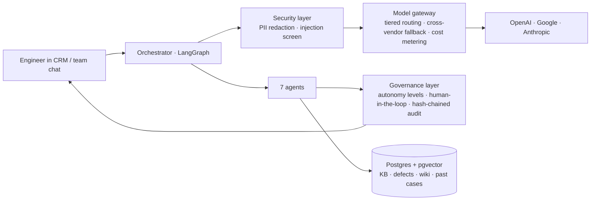
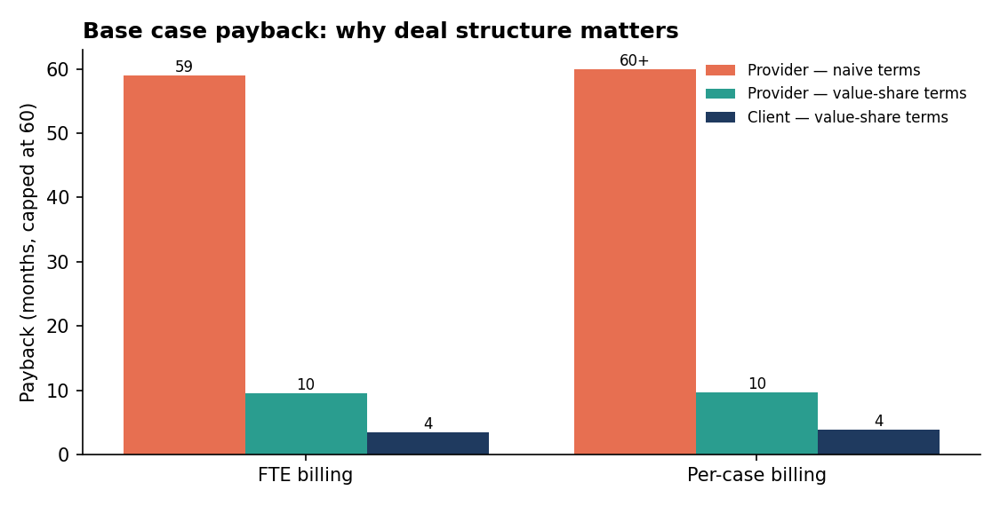

# FirstLine — Governed Agentic AI Copilot for Tier-1 Technical Support

**Seven AI agents that help outsourced support engineers resolve enterprise B2B cases on the first day, escalate less, and never send a customer something they'll regret — with a governance layer that keeps every customer-facing decision with a human, and an ROI model that works for both the client and the service provider.**

> Agentic AI · Customer Experience (CX) · Contact Center AI · Tier-1 / L1 Technical Support · BPO & Outsourcing · First Day Resolution · Escalation Reduction · RAG · LangGraph · AI Governance · Human-in-the-Loop · Responsible AI · Multi-vendor LLM (OpenAI · Google Gemini · Anthropic Claude) · Lean Six Sigma DMAIC · Agile · Outcome-based Pricing · Gainshare ROI

---

## The problem

A Tier-1 support team serving enterprise IT and data teams hits its throughput and SLA targets — but **First Day Resolution sits at 10% against a 50% target**, and **7% of cases escalate to an expensive onshore senior team against a 5% target**. A case audit shows a significant share of cases contain at least one *preventable* miss:

- asking customers for logs they already sent · setting the wrong case status (and emailing a customer who's waiting on *us*)
- replies that misread the ask, or generic chatbot text pasted in · knowledge scattered across four systems
- slow manual analysis of many log types · missed meetings · swarms to seniors at the wrong time
- new fixes never reaching the knowledge base · fixed defects the customer never hears about
- misrouting by region and language · and, rarely but catastrophically, scripts that delete customer data

Every case is different — each customer's environment is its own puzzle — so more scripts won't fix it. Engineers need the right knowledge, analysis and guardrails **at the moment they work the case**.

## What FirstLine does — in one case

`python demo.py` runs a German-language case with an attached network trace, and a hurried draft reply. One draft trips six checks before it can reach the customer:

```
ROUTING         L1-EMEA-DE  (country DE → EMEA; detected German)
LOG ANALYSIS    PROXY_AUTH_407 → "Proxy requires authentication" → KB-1007 → next step
PRE-SEND        ✗ Asks for 2 artifacts the customer already attached (trace, server logs)
                ✗ Status "Hold" — customer never asked to pause → should be Pending Internal
                ✗ "Kindly do the needful", "we will update you" → specific rewrites offered
                ✗ Generic AI boilerplate, nothing specific to this environment
                ✗ 2 customer questions unanswered — incl. their meeting request
COMMITMENTS     Tuesday 10:00 CET → reminders at T-60 and T-10
SCRIPT GUARD    "Get-ChildItem … | Remove-Item -Force" → BLOCK (senior override only)
GOVERNANCE      send_customer_reply: BLOCKED · change_case_status: BLOCKED · audit chain verified
COST            $0.001 for this pass
```

The engineer still sends the reply and sets the status. FirstLine makes sure they do it right.

## Thirteen problems → seven agents

| Agent | Problems solved | KPI moved |
|---|---|---|
| **Smart Routing** | Misrouting by region, language, complexity | First response, CSAT |
| **Unified Knowledge** (RAG) | Knowledge split across KB / defects / wiki / past cases; new fixes never captured | **FDR, Elevation %** |
| **Compose Assist** | Second-language comprehension & writing; generic pasted AI answers; no value-add | CSAT, FDR |
| **Case Governance** | Repeat asks; wrong status; forgotten accepted-defect cases; endless email ping-pong | CSAT, FDR |
| **Commitment & Swarm Tracker** | Missed meetings/messages; swarm timing; unread senior replies | **Elevation %**, CSAT |
| **Log Analysis** | Slow manual analysis across many log types | **FDR, Elevation %** |
| **Script Guard** | Destructive scripts shared with customers | Incidents → zero |

Every problem has a documented symptom → root cause → how → KPI → measure in [docs/02-problem-statements.md](docs/02-problem-statements.md).

## Architecture



**Code before models.** Routing rules, status inference, log signatures, script analysis, redaction and audit are deterministic — free, instant, explainable. Models are used only where language understanding pays for itself. → [docs/04-architecture.md](docs/04-architecture.md)

## Governance — the AI assists; people decide

| Autonomy | Meaning | Who has it |
|---|---|---|
| Suggest / Draft | Show warnings, prepare drafts | Six agents |
| Internal low-risk action | Create a reminder | Commitment Tracker only |
| **Customer-visible action** | Send, change status, close, share a script | **No agent — enforced in code and tested** |

Plus a **tamper-evident, hash-chained audit trail**, eval gates on held-out data before every release, and alignment with NIST AI RMF, ISO/IEC 42001 and EU AI Act transparency. → [docs/07-governance.md](docs/07-governance.md)

## Security

PII & secret redaction before any model call · prompt-injection screening of customer text and logs · least-privilege, read-only integrations · US-headquartered vendors only (sanctioned jurisdictions rejected at startup) · zero-data-retention terms · EU data routed to EU regions · a **fail-closed** script guard. → [docs/08-security.md](docs/08-security.md)

## Honest evaluation

Dev set: 100% on all 16 component metrics — and **that's not the headline**, because the rules and that set were written together. On a **held-out set** never used for tuning:

| Status validation | Log signatures | Routing | Retrieval hit@3 | Compose | Repeat-ask |
|---|---|---|---|---|---|
| 100% | 100% | 83% | 83% | 67% | 50% |

The misses are paraphrases and vocabulary gaps — exactly the cases the architecture sends to model tiers — so they're left unfixed as evidence, not patched to the test. One miss was different: the script guard **allowed** two destructive scripts it hadn't seen. A safety control failing *open* is unacceptable, so it was redesigned to fail *closed* and re-tested on a fresh set: **destructive scripts auto-allowed = 0.** → [docs/eval-report.md](docs/eval-report.md)

## Cost: a rifle, not a tank

Cross-vendor pricing compared (OpenAI, Google, Anthropic). Each task gets the cheapest tier that meets its accuracy bar, with a fallback from a different vendor.

**~$0.08 of model cost per case lifecycle** with tiered routing vs **~$0.24** using a frontier model for everything — ~2.8× cheaper, and under $100/month in tokens at illustrative volume. → [docs/05-model-selection.md](docs/05-model-selection.md)

## ROI — for both sides of the outsourcing relationship

Illustrative 19-FTE program, $4,000 per engineer per month, 700 L1 cases/month. Base case:

- **Client net benefit ≈ $20.5K/month · payback ≈ 5 months · 3-year net ≈ $634K** (conservative case: ~13-month payback, shown honestly with a slightly negative year 1)
- Biggest driver: onshore escalation cost avoided. Token prices don't make the top sensitivity drivers.

**The finding most business cases miss:** the value lands in the *client's* P&L, so naive terms fail the *provider* — under FTE billing it risks losing the headcount it just made more productive; under per-case billing its margin gain doesn't cover the platform. Modeled value-share terms fix both:

| Base case | FTE billing | Per-case billing |
|---|---|---|
| Client payback | **3.5 months** | **3.8 months** |
| Provider payback | **9.5 months** | **9.6 months** |
| Client share of value | 73% | 72% |



→ [docs/09-roi.md](docs/09-roi.md) · every input in [`roi/assumptions.json`](roi/assumptions.json)

## How it was managed

**Lean Six Sigma DMAIC** governs the business problem (measured baseline → root causes → improvement → control), and **Agile Scrum** delivers the build inside the Improve phase — three releases ordered by ROI and risk, each passing security, accuracy, shadow and pilot gates before the next. Charter, SIPOC, CTQ tree, RACI, RAID log, ADKAR change plan and control plan included. → [docs/01-project-charter.md](docs/01-project-charter.md) · [docs/10-delivery-plan.md](docs/10-delivery-plan.md)

## Quick start

```bash
pip install -r requirements.txt
python demo.py                 # one case end to end
python -m pytest tests/ -q     # 22 tests: governance, security, agents, ROI invariants
python -m eval.run_eval        # dev, held-out, and fresh held-out results
python -m roi.run_roi          # scenarios, deal structures, sensitivity, charts
```

Runs fully offline with zero API keys (deterministic model backend). Set `FIRSTLINE_LIVE=1` with vendor keys to wire real providers.

## Documentation

| | |
|---|---|
| [01 Project charter](docs/01-project-charter.md) | [06 RAG design](docs/06-rag-design.md) |
| [02 Problem statements](docs/02-problem-statements.md) | [07 Governance](docs/07-governance.md) |
| [03 Measure & analyze](docs/03-measure-analyze.md) | [08 Security](docs/08-security.md) |
| [04 Architecture & stack](docs/04-architecture.md) | [09 ROI](docs/09-roi.md) |
| [05 Model selection](docs/05-model-selection.md) | [10 Delivery plan](docs/10-delivery-plan.md) |
| [Eval report](docs/eval-report.md) | [Research notes](docs/research-notes.md) |

## Scope and honesty

All data, cases, companies and figures here are synthetic or illustrative — no real customer, client or employer information. Backend systems are mocked so the repo runs anywhere; `data/` and the model gateway's live adapters are the only parts that change for a real deployment. KPI improvements in the ROI model are projections to be validated by the pilot design in [docs/10-delivery-plan.md](docs/10-delivery-plan.md).

## License

MIT
