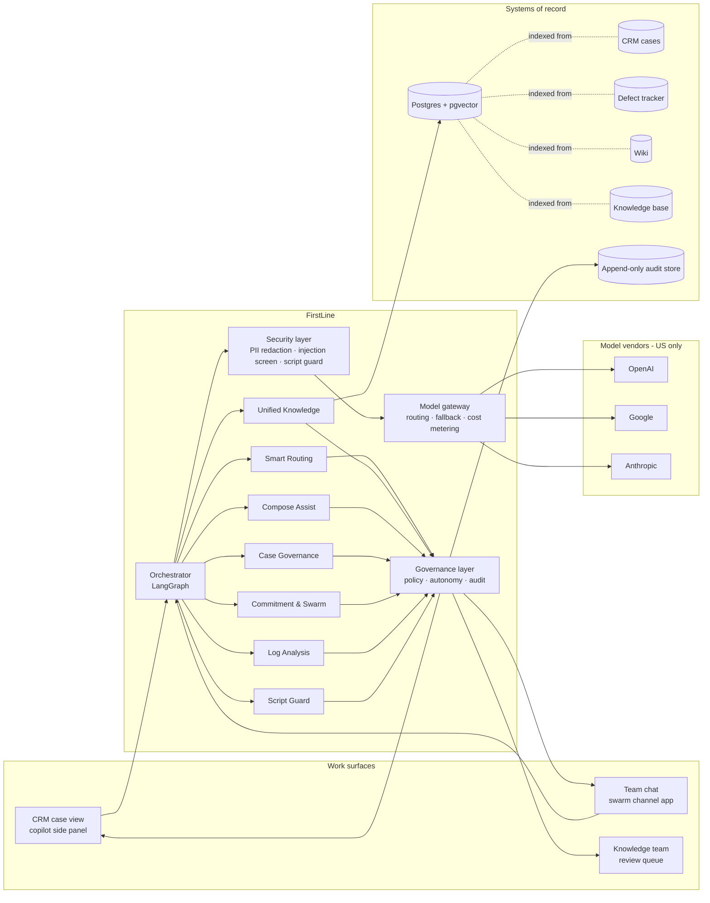

# 04 · Architecture & Tech Stack

## Design principles

1. **Assist, don't act.** Agents suggest and draft; engineers send and change state. (Governance, [07](07-governance.md).)
2. **Code before models.** Deterministic logic handles everything it can — free, instant, explainable. Models handle only what needs language understanding.
3. **Cheapest model that meets the accuracy bar**, with a cross-vendor fallback for every task. ([05](05-model-selection.md))
4. **Security at the boundary.** Every prompt passes PII redaction and injection screening before leaving. ([08](08-security.md))
5. **Integrate where engineers already work** — the CRM case view and team chat — not a new tool they have to remember to open.

## System view

## Four moments in a case's life

| Moment | Trigger | Agents | Output |
|---|---|---|---|
| **Intake** | Case created | Routing, Knowledge, Log Analysis | Queue recommendation; top articles & known defects; log findings — ready before the engineer opens the case |
| **Pre-send** | Engineer drafts a reply | Compose Assist, Case Governance, Script Guard | Warnings + suggested rewrite + correct status, before anything reaches the customer |
| **Background** | Scheduled / event-driven | Commitment & Swarm, Case Governance (defect watch, aging Hold) | Internal reminders and nudges |
| **Resolution** | Case closed | Knowledge Capture | KB draft into the knowledge team's queue if the fix is new |

## Tech stack — and why each piece

| Layer | Choice | Why | Don't use until… |
|---|---|---|---|
| Orchestration | **LangGraph** | Explicit state graph = an auditable path for every case; conditional routing; mature in production | — |
| API / services | **FastAPI** (Python) | Async I/O for model and system calls; typed; standard for agent backends | — |
| Relational + vector store | **PostgreSQL + pgvector** | One database for app data *and* embeddings. Knowledge corpus is thousands of documents, not billions — a dedicated vector DB adds cost and ops without benefit | Tens of millions of vectors or very high QPS |
| Model gateway | Thin in-house gateway (this repo) or an open-source gateway such as **LiteLLM** | Single choke point for redaction, cost metering, fallback, vendor switching | — |
| Observability & tracing | **LangSmith** or open-source **Arize Phoenix** | Per-node traces to debug any suggestion | — |
| Evals | This repo's harness + **promptfoo** in CI | Every prompt/model change must pass evals before release | — |
| Cache / jobs | **Redis** + cloud-managed scheduler | Reminders, defect watch, swarm SLA timers | — |
| Hosting | **Serverless containers** (Cloud Run / Azure Container Apps / ECS Fargate) | Support traffic follows business hours across regions; pay for use | Kubernetes only at sustained high load |
| Secrets | Cloud KMS / Key Vault | No keys in code or config | — |
| DLP (production) | Cloud DLP (e.g. Google Sensitive Data Protection or Microsoft Purview) in front of the pattern redactor | Managed detectors + pattern backstop | — |
| Work surfaces | CRM side-panel component; team-chat app; calendar API for reminders | Meet engineers where they already work | — |

## Deployment tiers

| Tier | What it is | When to use |
|---|---|---|
| **0 · Starter** | Custom assistants inside an enterprise chat workspace (with an enterprise AI subscription), loaded with the same prompts and a knowledge export | Validating prompt quality in a week, with no integration budget. **Limits:** no pre-send enforcement, no audit chain, no CRM context, manual copy-paste |
| **1 · Standard** | This architecture, API-based, CRM side panel + chat app | The recommended production target |
| **2 · Full** | Tier 1 + event-driven background agents + routing platform integration | After Tier 1 pilot passes its go/no-go gate |

Tier 0 exists because many organizations already pay for enterprise AI seats and can prove value there before approving API spend — but it cannot enforce the governance model, so it's a stepping stone, not a destination.

## Data residency

EU customer data is processed in EU regions via the vendors' enterprise cloud channels (e.g. Azure OpenAI EU regions, Google Vertex AI EU regions, Anthropic models via cloud-provider EU regions), with zero-data-retention terms. The gateway routes by the case's region.
