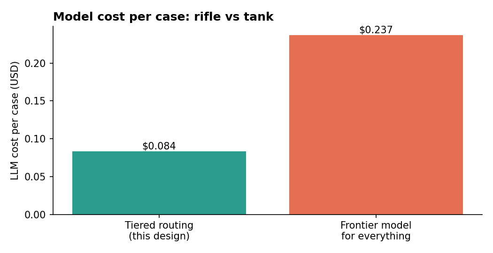

# 05 · Model Selection — Cost vs Accuracy

## Policy

- **US-headquartered vendors only**, via enterprise terms with zero data retention available. Models from sanctioned jurisdictions are rejected by `firstline/config.py` at startup — a code-enforced rule, not a convention.
- **Rifle, not tank.** Every task gets the cheapest tier that meets its accuracy bar. Deterministic code comes before any model.
- **No single-vendor dependency.** Every task has a same-tier fallback from a *different* vendor (enforced by a unit test).
- **Price honestly.** Promotional prices are replaced with post-promotion list prices in the cost model, so ROI doesn't depend on a discount that expires.

## Cross-vendor pricing (USD per 1M tokens, standard tier, September 2026)

| Tier | OpenAI | Google | Anthropic |
|---|---|---|---|
| Budget | GPT-5 nano $0.05 / $0.40 | Gemini 3.1 Flash-Lite $0.25 / $1.50 | — |
| Mid | GPT-5 mini $0.25 / $2.00 | Gemini 3.8 Flash $1.50 / $7.50 *(list; $0.75 / $3.75 promo to Dec 2026)* | Claude Haiku 4.5 $1.00 / $5.00 |
| Reasoning | GPT-5.6 Terra $2.00 / $12.00 | Gemini 3.1 Pro $2.00 / $12.00 | Claude Sonnet 5 $2.00 / $10.00 |

Prices move often — re-verify before any budget decision. Reasoning-capable models also bill hidden "thinking" tokens as output, so real cost can exceed the listed rate; the cost model adds a 30% buffer.

## Task assignments

| Task | Primary | Fallback | Why this tier |
|---|---|---|---|
| Case classification, language detection | GPT-5 nano | Gemini 3.1 Flash-Lite | Short structured output; high volume; cheapest option across all vendors |
| Thread summarization | GPT-5 nano | Gemini 3.1 Flash-Lite | Extraction, not judgment |
| Semantic repeat-ask detection | GPT-5 mini | Claude Haiku 4.5 | Needs paraphrase understanding ("build number" = "version") |
| Reply review & rewrite | GPT-5 mini | Claude Haiku 4.5 | Tone and nuance for native-English enterprise readers |
| Customer-intent explanation (native language) | GPT-5 mini | Gemini 3.8 Flash | Multilingual quality at low cost |
| Knowledge answer synthesis | GPT-5 mini | Claude Haiku 4.5 | Grounded summarization with citations |
| KB article drafting | GPT-5 mini | Claude Haiku 4.5 | Structured writing; reviewed by humans anyway |
| Long log summarization | Gemini 3.8 Flash | GPT-5 mini | Flat pricing on very long inputs; large context window |
| Hard multi-log correlation | Claude Sonnet 5 | Gemini 3.1 Pro | ~5% of cases; genuine reasoning required |
| Script risk explanation | Claude Sonnet 5 | Gemini 3.1 Pro | Rare; explanation quality matters. **The verdict itself is deterministic** |
| Embeddings | text-embedding-3-small | — | Cheap; batch cost, not per-case |

## What deterministic code does instead of a model

Routing rules, status inference, artifact matching, log signature matching, script static analysis, PII redaction, injection screening, audit hashing, swarm scoring. That covers the majority of decisions at zero token cost — and every one of them is explainable in a sentence.

## Result

LLM cost per case over its full lifecycle ≈ **$0.08** with tiered routing vs **$0.24** if a frontier model were used for everything — about **2.8× cheaper**. At illustrative volume that's under $100/month in tokens: model spend is a rounding error next to platform, maintenance and — above all — the cost of a wrong answer. That's why accuracy-critical decisions (script verdicts, status rules, audit) are deterministic, and money is spent on models only where language understanding pays for itself.

