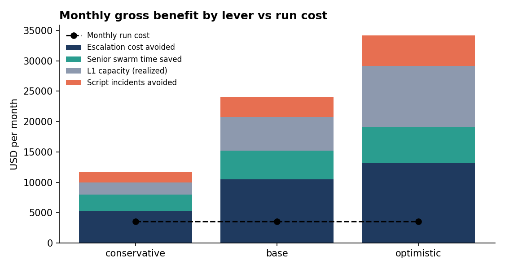
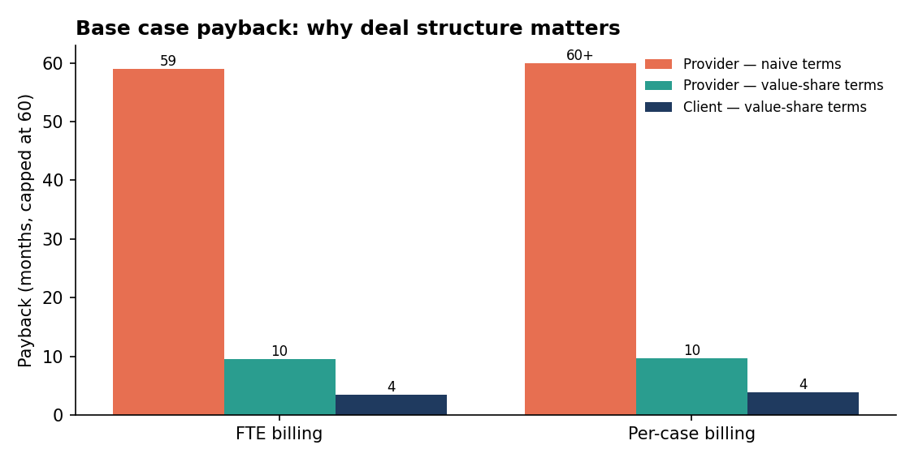

# 09 · ROI — Two Billing Models, Two Beneficiaries

> All figures are **illustrative projections** from `roi/assumptions.json`, for a generic outsourced Tier-1 program (14 L1 engineers, 3 licensing, 2 knowledge = 19 billed FTE; 700 L1 cases/month). Replace inputs with your own data and run `python -m roi.run_roi`. A pilot replaces projections with measured results.

## Where the value comes from (and what's deliberately not counted)

| Lever | Formula | Cash or capacity? |
|---|---|---|
| **Escalation cost avoided** | L1 cases × (baseline elevation % − new elevation %) × onshore cost per elevated case | **Cash** — onshore senior time no longer spent |
| **Senior swarm time saved** | swarm hours before − (fewer swarms × shorter swarms) × onshore hourly cost | **Cash** |
| **L1 capacity** | (L1 FTE × productivity gain − FTE absorbed by work pulled back from Core) × rate × realization % | **Capacity** — only counted at a stated realization rate, because freed hours aren't savings until used |
| **Script incidents avoided** | incidents avoided/yr × cost per incident ÷ 12 | **Cash** (escalation handling, service credits) |
| Retention upside | supported ARR × churn reduction | **Off by default** — real, but the easiest number to challenge |
| **Run cost** | tokens (measured per task × volume, +30% buffer) + platform + maintenance | Cost |
| **One-time** | build + security review & pen test | Cost |

Two rigor choices worth calling out: capacity is **netted** for the work L1 absorbs when escalations drop (otherwise the same benefit is counted twice), and retention is **excluded** from the base case.

## Scenarios (client view)

| | Conservative | Base | Optimistic |
|---|---|---|---|
| Elevation 7% → | 6.0% | 5.0% | 4.5% |
| FDR 10% → | 20% | 30% | 40% |
| L1 productivity gain | 8% | 15% | 22% |
| **Client net benefit / month** | **$8,071** | **$20,520** | **$30,626** |
| Payback on $105K one-time | 13.0 months | **5.1 months** | 3.4 months |
| Year-1 ROI | −7.8% | 134.5% | 250.0% |
| 3-year net | $185,539 | **$633,726** | $997,550 |

The conservative case shows a slightly negative first year. That's left visible on purpose: a model where every scenario wins immediately reads as reverse-engineered.

## The commercial finding: naive terms fail the provider

Most of the value lands in the **client's** P&L (onshore escalation and swarm cost). That creates a problem in both billing models:

**FTE billing ($4,000 per engineer per month).** Productivity frees ~1.9 FTE net. If the client simply cuts that headcount, the provider loses ~$7,400/month of revenue — for a program it co-funded. A cost-plus AI enablement fee alone gives the provider a ~59-month payback.

**Per-case billing (parity price $80/case = $4,000 ÷ 50).** The provider's unit cost falls from $56 to ~$49, but with a 50% price gainshare and the provider carrying the platform run cost, the margin gain doesn't cover the run cost. No payback.

A deal that only works for one side of an outsourcing relationship doesn't get signed.

## Recommended value-share terms

Share only **verifiable cash savings** (escalation cost, swarm time, incidents) — never the softer capacity value.

| Term | FTE billing | Per-case billing |
|---|---|---|
| Headcount | Held; freed capacity absorbs work pulled back from Core and volume growth | n/a |
| AI enablement fee | Run cost + 25% | — |
| Outcome share to provider | 25% of verified cash savings | 20% of verified Core savings |
| Price gainshare to client | — | 25% of unit-cost reduction |
| Platform run cost | In the fee | Split 50/50 |
| One-time build | Split 50/50 | Split 50/50 |

| Base scenario | FTE billing | Per-case billing |
|---|---|---|
| Client net / month | $15,003 | $13,863 |
| Provider net / month | $5,517 | $5,458 |
| **Client payback** | **3.5 months** | **3.8 months** |
| **Provider payback** | **9.5 months** | **9.6 months** |
| Client share of value | 73% | 72% |

The client keeps roughly three-quarters of the value and pays back in under four months; the provider pays back in under ten months and turns a headcount-risk conversation into a growth one.

## Sensitivity — what if we're wrong?

Each assumption moved ±25% on its own (base case client net = $20,520/month):

| Assumption | 25% worse | 25% better |
|---|---|---|
| Onshore Core loaded cost | −$3,794 | +$3,794 |
| Elevation reduction achieved | −$2,442 | +$2,442 |
| L1 productivity gain | −$1,600 | +$1,598 |
| Capacity realization | −$1,392 | +$1,392 |
| Script incidents avoided | −$833 | +$833 |
| Swarm volume reduction | −$554 | +$554 |
| Platform + maintenance run cost | −$375 | +$375 |

The two biggest drivers — onshore cost and elevation reduction — are exactly what the pilot measures first. **LLM token prices don't appear in the top drivers at all**: at ~$0.08 per case, tokens are under $100/month. Cost optimization of the models matters for principle and scale; accuracy matters for the business case.

## What the pilot must prove

1. Elevation % reduction on the pilot cohort vs a control cohort.
2. FDR change on the same basis.
3. Suggestion acceptance rate and false-alarm rate per agent.
4. Measured tokens per case (replacing the budget in `assumptions.json`).
