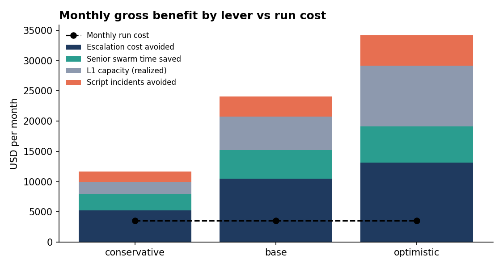
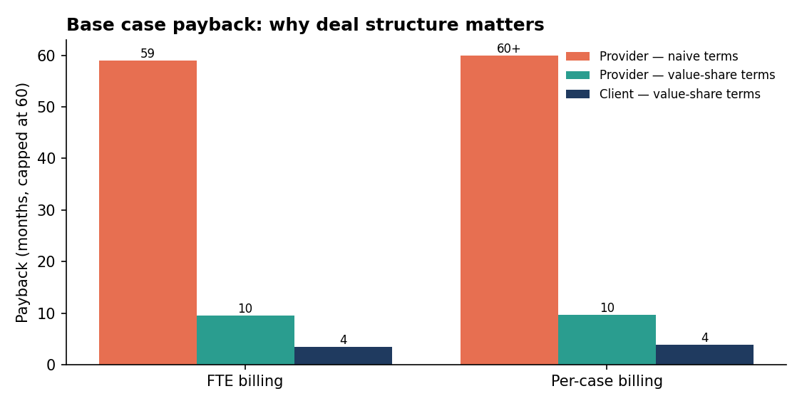
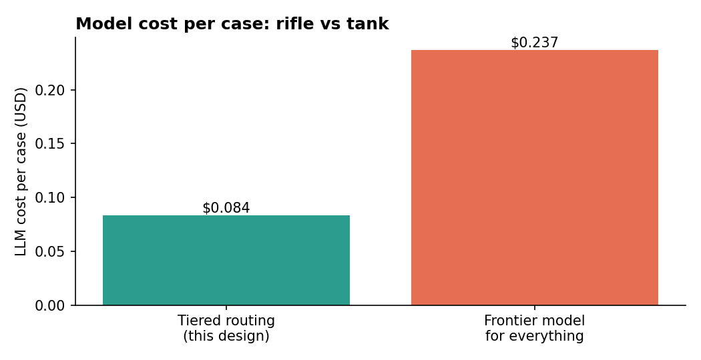

# ROI Report (generated)

> Illustrative model for a generic outsourced Tier-1 B2B technical support program. All inputs live in `roi/assumptions.json`. These are **projections**, to be replaced with measured pilot data.

## Headline (base scenario, before deal structuring)

- Client net benefit: **$20,520/month**, **$246,242/year**
- Payback on full one-time cost ($105,000): **5.12 months**
- 3-year net value: **$633,726**
- LLM cost per case: **$0.0836** (tiered) vs **$0.2368** (frontier-for-everything)

## Scenarios

| Metric | Conservative | Base | Optimistic |
|---|---|---|---|
| Escalation cost avoided / mo | $5,250 | $10,500 | $13,125 |
| Senior swarm time saved / mo | $2,732 | $4,676 | $6,005 |
| L1 capacity value (realized) / mo | $1,981 | $5,570 | $10,055 |
| Script incidents avoided / mo | $1,667 | $3,333 | $5,000 |
| Run cost / mo | $3,559 | $3,559 | $3,559 |
| **Client net / mo** | $8,071 | $20,520 | $30,626 |
| Payback (months) | 13.01 | 5.12 | 3.43 |
| Year-1 ROI % | -7.77 | 134.52 | 250.02 |
| 3-year net | $185,539 | $633,726 | $997,550 |

## Commercial structures

### Naive terms (why they fail)

- **FTE billing:** productivity frees ~1.86 FTE. If the client converts that into headcount cuts, the provider loses $7,426/month. With only a cost-plus enablement fee, provider payback on a 50% build share is 59.0 months.
- **Per-case billing with 50% price gainshare:** provider margin gain is smaller than the platform run cost it carries — no payback.

Most of the value lands in the client's P&L (onshore escalation cost). Unshared, the provider has no reason to fund it.

### Recommended value-share terms

| Base scenario | FTE billing | Per-case billing |
|---|---|---|
| Client net / mo | $15,003 | $13,863 |
| Provider net / mo | $5,517 | $5,458 |
| Client payback (months) | 3.5 | 3.8 |
| Provider payback (months) | 9.5 | 9.6 |
| Client share of value % | 73.12 | 71.75 |

Per-case price after gainshare: $78.19 (from $80.0 parity).

## Sensitivity (base case, each assumption moved ±25%)

| Assumption | Change if 25% worse | Change if 25% better |
|---|---|---|
| Core loaded cost / engineer | -$3,794 | +$3,794 |
| Elevation reduction achieved | -$2,442 | +$2,442 |
| L1 productivity gain | -$1,600 | +$1,598 |
| Capacity realization | -$1,392 | +$1,392 |
| Script incidents avoided / yr | -$833 | +$833 |
| Swarm volume reduction | -$554 | +$554 |
| Platform + maintenance run cost | -$375 | +$375 |

Even with the largest single driver 25% worse, the base case stays strongly positive.
